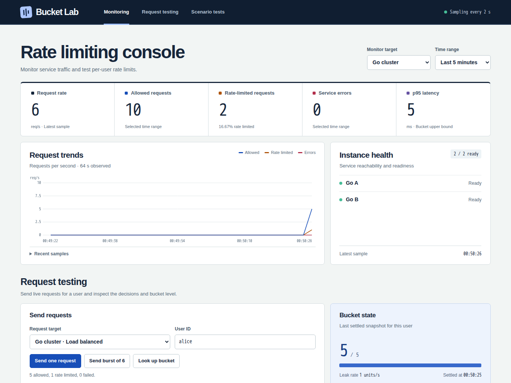

# Leaky Bucket Rate Limiter

A small REST service that decides whether a user can make one more request. The standalone Clojure service keeps each user's bucket in memory. The Go and Redis implementation shares each user's quota across two application instances. Both implementations run the same time-based test cases.

[Clojure walkthrough and live demo](docs/interview.md)

## Run the standalone service

Run the following commands from the repository root. You need Make, a running Docker engine and the Docker Compose plugin with support for `up --wait`.

```sh
make standard       # Start only the Clojure service on 127.0.0.1:8081
make test-standard  # Run the Clojure core, HTTP and Jetty tests
```

The first build downloads dependencies. The container includes the JVM and the application libraries. These two calls submit a request and then read the recorded decision state.

```sh
curl -i http://127.0.0.1:8081/v1/check \
  -H 'Content-Type: application/json' -d '{"user_id":"alice"}'

curl -s http://127.0.0.1:8081/v1/buckets/alice
```

For a new user with the default settings, the first call returns HTTP 200. The example below uses an illustrative Unix timestamp.

```json
{"allowed":true,"instance":"clojure","bucket":{"level":1,"updated_at":1700000000,"capacity":5,"leak_rate":1.0}}
```

## How admission works

One limiter owns a map of independent user buckets. Each request costs one unit. The core computes the elapsed time since that user's last decision, subtracts the leaked amount, clamps the level at zero, and allows the request when adding one stays within capacity. A rejected request still settles elapsed time. If the clock moves backwards, the last settlement time is retained.

| Time in seconds | Request for Alice, capacity 5 and leak rate 1/s | Decision and recorded level |
| --- | --- | --- |
| 0 | Five requests arrive together | All five pass; level 5 |
| 0 | Sixth request | 429; level 5 |
| 0.5 | Another request | 429; level 4.5 |
| 1 | Another request | 200; level 5 |

A new user can still spend their full quota at any point in this example. The calculation runs on demand, so there is no background timer or request queue. The [Clojure core](standard/src/limiter/core.clj) exposes `create-rate-limiter`, `allow-request`, and `get-bucket-state`. `allow-request` takes a Unix timestamp and returns the decision and a new immutable limiter. Only the [HTTP adapter](standard/src/limiter/http.clj) reads the clock and commits the new state. A short critical section serializes competing Jetty requests.

## HTTP contract

Use `Content-Type: application/json` on POST. Both request bodies accept one field, a nonempty string named `user_id`, and have a 64 KiB size limit. Time is assigned by the server.

| Endpoint | Behavior |
| --- | --- |
| `POST /v1/check` | Returns 200 when allowed or 429 when less than one unit of capacity remains after leakage. Both include the resulting bucket snapshot. An invalid request returns 400. |
| `GET /v1/buckets/{user_id}` | Returns the most recently settled snapshot or 404 for an unknown bucket. URL-encode the user ID as one path segment. |
| `POST /v1/bucket-state` | Read-only lookup with the same JSON body as a check. Use it for long IDs and IDs such as `.` or `..` that browsers normalize in paths. Reading consumes no quota and creates no bucket. |
| `GET /livez`, `GET /readyz` | Process liveness and service readiness. Go readiness includes a Redis connectivity check. |

The snapshot's `level` is measured at `updated_at`, expressed in Unix seconds. Refreshing the lookup returns the same stored values until another decision or Redis key expiry. The Clojure core returns `nil` for an unknown user. HTTP represents that outcome as 404.

## Optional Go and Redis demo

| Command | Result |
| --- | --- |
| `make up` | Build and start Clojure, Go A and B, HAProxy, Redis and the console. Print the live URLs when healthy. |
| `make demo` | Send real requests to demonstrate recovery, user isolation and shared quota across replicas. |
| `make test` | Run the full suite in an isolated Compose project with ephemeral host ports and a separate Redis volume. |
| `make deploy` | Start the same stack on the current Docker host. Published ports bind to loopback. |
| `make status` / `make down` | Inspect service health or stop the stack while retaining the Redis volume. |

Open the [local console](http://127.0.0.1:8080/) or send requests directly to the Go gateway on port 8082. In the console, **Test shared quota** runs the shared-quota scenario. Go A accepts the first request, Go B reads its snapshot, and subsequent requests alternate between them. **Request testing** opens the manual request controls.



### Design and operational limits

- **State and clock.** Each Clojure process keeps historical user entries until restart. The Go service runs one Lua script per admission to read Redis time, settle a user's bucket and commit the decision atomically. The key expires when its level can drain to zero. A lookup of a reclaimed key returns 404. [Redis implementation](distributed/check.lua)
- **Failure behavior.** HAProxy routes traffic to the surviving Go instance after detecting a process failure. If Redis is unavailable, Go returns 503. A timeout can arrive after Redis has applied a write, so the service avoids automatically retrying a decision with an unknown outcome. When both Go instances are down the gateway identifies itself in the JSON 503 response. [Gateway configuration](ops/haproxy.cfg) · [HAProxy error response directive](https://docs.haproxy.org/3.2/configuration.html#4-http-error)
- **Availability boundary.** The deployment uses one Docker host and one Redis server. Redis uses an AOF volume with a one-second fsync policy. The tests exercise process loss, clean Redis shutdown and recovery. A host or storage failure can lose recent decisions and requires a separate recovery design.
- **Observability.** The console polls each instance every two seconds and keeps 30 minutes of history in memory. It tracks admission requests received by the application instances from any client. Rejections and service errors have separate counters. If HAProxy answers a request because both replicas are offline, the manual request log shows that response and the replica charts show a sampling gap. The p95 is a histogram bucket upper bound for the selected instances. The UI marks partial or missing sampling intervals. [Collector](console/monitor.go)

**Changing the policy.** Redis records the capacity and leak rate with each bucket. A busy bucket keeps its original settings across a rolling update. Once it drains, its next request adopts the settings of the instance handling that request. A continuously busy user can therefore stay on the previous policy. The snapshot reports the policy actually used. New buckets may receive either policy while a mixed rollout is in progress.

If upgrading an existing volume from the original untagged bucket format, deploy the new code to **both** Go instances with the existing settings first. Before changing them, allow one full bucket drain time (`capacity / leak_rate` seconds plus 1 ms) after the last old process stops. Accessed buckets acquire their original policy, and unaccessed buckets expire. A legacy bucket without a finite Redis TTL needs an explicit migration.

Redis keys for this version use the `leakybucket:limiter:v1:` prefix. When switching from a different prefix, stop writes to the old namespace and wait for its buckets to drain, or migrate the keys with their expiry times before starting both replicas on the new prefix.

Capacity and leak rate default to `CAPACITY=5` and `LEAK_RATE=1.0`. Host port overrides are `STANDARD_PORT`, `GO_PORT` and `CONSOLE_PORT`. Run `make up` after changing settings. For a remote demo, run `make deploy` on the Linux host and open an SSH tunnel, for example `ssh -L 8080:127.0.0.1:8080 user@host`.

## What the tests establish

The [shared contract cases](contracts/cases.json) cover bursts, fractional leakage, clock rollback, user isolation and the exact admission boundary after repeated rejections. The isolated suite sends 100 concurrent HTTP requests for one user to two real Go containers with a leak rate slow enough to prevent one unit from draining during the test. At capacity five, exactly five requests must pass. It then stops an application instance, stops and restores Redis, and checks the responses and retained state. Browser tests exercise the console, including metrics collected while the page is closed and Redis failure reporting. Run `make test` to reproduce the checks.
