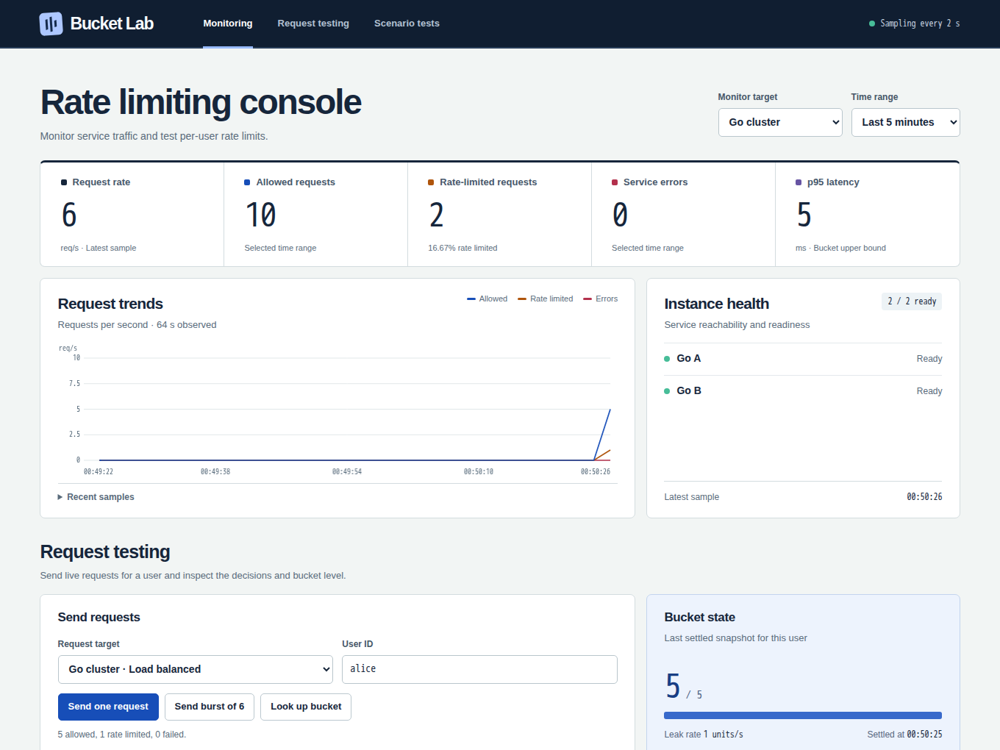

# 漏桶限流器 · 简体中文项目指南

后端作业。一份可独立运行的 Clojure 正式答卷，一份 Go + Redis 双实例扩展，以及一个可以发送真实流量的中文操作台。默认每个用户拥有容量 **5**、每秒漏出 **1** 单位的桶。

[English project introduction](README.md) · [从零读懂 Clojure 实现](docs/interview.md)

## 第一次看这个项目，从哪开始

| 想弄清楚的问题 | 建议先看 | 阅读时留意 |
| --- | --- | --- |
| 请求为什么会被拒绝？ | [三个核心函数](standard/src/limiter/core.clj) | 跟踪一个用户的 `level` 和 `as_of`，看拒绝时哪一项仍会更新 |
| 两个并发请求同时抢最后一个额度会怎样？ | [HTTP 适配层](standard/src/limiter/http.clj) | 找到 `admit!`，确认返回给调用方的决定和保存的新状态来自同一次计算 |
| 一套规则如何检验两种语言？ | [共享测试向量](contracts/cases.json) | 手算每步，再对比 `allowed`、`level`、`as_of` 三列 |
| 为什么 Go A 能用 Go B 的额度记录？ | [Redis 脚本](distributed/check.lua) 和 [状态转移](distributed/advance.lua) | 对同一用户，把取时、结算、判定、写回放进一次原子操作 |
| 页面上的数字从哪里来？ | [采样器](console/monitor.go) | 页面统计相邻采样的差值。关掉浏览器后，通过 API 发请求仍会被计数 |

建议先运行 Clojure 答卷，手动观察一次放行和一次查桶。能解释“查询为什么不扣额度”之后，再看 Go 版怎样在两个进程间保持相同的保证。

## 本地运行与验收

在仓库根目录运行命令，需要已启动的 Docker 引擎、支持 `up --wait` 的 Docker Compose 插件和 Make。首次构建需要联网下载依赖；本机无需安装 Clojure、Go、Node 或 Redis。

| 命令 | 用途 |
| --- | --- |
| `make standard` | 只运行 Clojure 正式答卷，打印可复制的 curl 示例 |
| `make test-standard` | 单独运行标准答案的核心、HTTP 和 Jetty 测试 |
| `make up` | 构建并启动两个版本与操作台，等待服务健康后打印地址 |
| `make demo` | 在已启动的完整环境中执行三组真实请求，现场检查预期结果 |
| `make test` | 用独立 Compose 项目运行所有测试，含真实 Redis、浏览器及停机恢复演练；结束后清理测试容器与卷 |
| `make deploy` | 在当前 Linux Docker 主机部署同一套服务，使用重启策略、健康检查与 Redis 数据卷 |
| `make status` / `make down` | 查看实例状态 / 关闭当前项目并保留数据卷 |

默认[演示操作台](http://127.0.0.1:8080)使用 8080 端口，Clojure 使用 8081，Go 集群入口使用 8082。在操作台点击「验证跨实例共享」，可以看到 A 写入后 B 查到同一个桶，两个实例交替处理请求直到额度耗尽。用下方 curl 在页面外打流量，操作台也会采样。三个发布端口均仅绑定回环地址，Redis 和单个 Go 副本仅在 Compose 网络内访问。

```sh
curl -i http://127.0.0.1:8081/v1/check \
  -H 'Content-Type: application/json' -d '{"user_id":"alice"}'
curl -s http://127.0.0.1:8081/v1/buckets/alice
```



## 核心接口和行为

标准答案从 [核心函数](standard/src/limiter/core.clj) 开始阅读。核心的三个公开函数是 `create-rate-limiter`、`allow-request`、`get-bucket-state`。每个请求按 `max(0, 上次水位 − 漏速 × 经过秒数)` 结算，再尝试加一。结果等于容量时仍允许。核心显式接受 Unix 秒，HTTP 入口自己取时间。服务对一次检查立即给出决定，空桶可以瞬间吸收一个容量大小的突发。

| HTTP 操作 | 返回 |
| --- | --- |
| `POST /v1/check`，JSON 为 `{"user_id":"alice"}` | `200` 放行，`429` 配额耗尽；均返回 `allowed`、`instance` 和 `bucket` |
| `GET /v1/buckets/{用户ID}` | `200` 和最近结算快照；未知桶 `404`。路径段中的特殊字符需要 URL 编码 |
| `POST /v1/bucket-state`，JSON 传 `user_id` | 只读查桶，与 GET 返回相同快照；支持浏览器会规整的 `.`、`..` 和不适合放进 URL 的长 ID |
| `GET /livez`、`GET /readyz` | 检查进程存活、业务依赖就绪。Go 在 Redis 故障时仍可提供存活状态和指标 |

两个 POST 接口接受恰好一个名为 `user_id` 的字段，值为非空字符串，JSON 正文上限为 64 KiB。

水位快照包含 `level`、Unix 秒 `as_of`、`capacity` 和 `leak_rate`。调试查询不会推进时间或创建桶。空 ID、客户端传入的时间戳等无效请求返回 `400`。Redis 超时或不可用返回 `503`，调用方可能无法确认本次写入是否已经完成。

## 设计取舍

- **标准版**用不可变 map 表达每次状态转移。Jetty 适配层仅在提交时进入临界区，让一次 HTTP 答复对应一次成功提交。时间由测试直接传入，无需定时线程。单进程重启会清空所有桶；保留用户记录使历史快照可查，内存随用户数增长。
- **分布式版**由 HAProxy 分发给 Go A 和 Go B。Redis 在同一个脚本中读取服务端时间、结算和写入单用户的桶。读快照不修改键。键在计算出的排空时刻之后回收，回收后的 GET 返回 404。Redis 写入结果不明时返回 503，禁止盲重试。活跃桶保存实际采用的容量和漏速，滚动发布时切换到另一个实例也能延续原策略。
- **监控**逐实例读取内部计数及延迟直方图，每 2 秒采样，保留最近 30 分钟。只计有效的准入调用，429 与服务端错误分别展示。p95 取合并直方图的分箱上界。只统计有连续采样的区间；实例重启和采集中断会在页面留下缺口。操作台重启后重新采集。
- **部署**能容忍单个 Go 进程退出。宿主机和单 Redis 仍是故障点。Redis 使用 AOF 每秒刷盘和持久卷；非正常掉电可能丢失最近写入。更严格的服务目标需要独立故障域和对故障切换期间配额误差的明确约定。停机测试实际关闭副本和 Redis，再验证恢复。两个 Go 副本都停止时，HAProxy 自己返回带 `instance: gateway` 的 JSON 503。

## 测试与配置

[共享测试数据](contracts/cases.json)定义时间线和预期结果，两个版本运行同一份数据。全套验收另外覆盖双实例同用户并发 100 次、不同用户隔离、状态读取、应用实例下线、Redis 停止与恢复、页面交互、监控采集和刷新保留。测试使用临时端口、独立 Redis 和数据卷，不会停止正在演示的服务。

`CAPACITY` 和 `LEAK_RATE` 可以在运行 Make 前设置。默认端口可用 `CONSOLE_PORT`、`STANDARD_PORT` 和 `GO_PORT` 修改。演示建议使用默认值。远程 Linux 上执行 `make deploy` 后，可从个人电脑运行 `ssh -L 8080:127.0.0.1:8080 用户@主机` 访问服务器操作台。

### 滚动修改容量或漏速

例如旧容量为 1，用户刚发完一次请求；新副本配置的容量为 5。如果读取后直接套用 5，这个用户马上就能多发请求。Go 版把实际采用的策略与桶状态一起保存。旧桶排空前仍按原策略判定并回显；排空后的第一条请求使用接收它的实例配置。持续不空的桶可能长时间沿用原策略，混合发布期间新用户也可能先遇到任一版本。

如果复用初版未存策略的 Redis 数据卷，先保持原配置升级所有 Go 副本。从最后一个旧进程停止后，至少等待原容量 ÷ 原漏速的秒数，再加 1 毫秒的到期取整余量，然后调整参数。这段时间内，有流量的旧桶会补上策略，无流量的旧桶会自然过期。极小漏速导致没有有限 TTL 的旧键需要单独迁移。

### 如何读操作台

“放行”和“限流”都是已经作出的决定。`429` 表示额度已耗尽；`503` 表示服务无法确认这次扣量结果。p95 显示所选实例合并后第 95 百分位落入的耗时分箱上界。例如显示 10 毫秒，表示该次采样的 p95 落在不超过 10 毫秒的分箱内。实例离线或刚重启时，观察“部分”或“缺失”标识。两个 Go 副本都离线时，手动请求记录会显示网关的 503；副本没有收到这次请求，对应的统计区间会显示采样缺口。

浏览器刷新后仍可查看采集服务保留的最近 30 分钟；重启操作台服务会清空这段历史。用户的水位和监控历史分别存储，二者的保留时间也不同。
