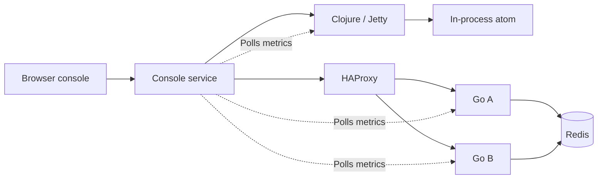

# A Clojure Leaky Bucket Walkthrough

[Project README](../README.md)

## Work through the numbers first

Suppose Alice sends five requests at second 0 and fills her bucket to 5. At second 0.5, half a unit has leaked. Adding one to 4.5 would overflow the bucket, so the service returns `429` and stores **level 4.5 at second 0.5**. At second 1, another half unit has leaked. The level is now 4, so there is room for exactly one request. Updating only the timestamp would lose credit for the first half-second. Updating only the level would count that same time twice on the next check.

Run `make standard` from the repository root, then use the command below to open a Clojure REPL in the running container. The REPL runs in a separate process, so defining values there leaves the HTTP service's buckets alone. If you have the Clojure CLI installed locally, you can also run `clojure` from the `standard` directory.

```sh
docker compose exec clojure java -cp 'src:/app/lib/*' clojure.main
```

Enter these expressions one at a time. The `M` suffix marks a decimal literal in Clojure.

```clojure
(require '[limiter.core :as limiter])

(def empty-limiter (limiter/create-rate-limiter 5 1.0M))
(def decision (limiter/allow-request empty-limiter "alice" 0M))
(first decision)                                    ; true
(limiter/get-bucket-state empty-limiter "alice")      ; nil, because the original limiter stays empty
(limiter/get-bucket-state (second decision) "alice")  ; Level 1, settled at second 0
```

`(function argument argument)` calls a function, `{:level 1}` is a map, and `[allowed? next-state]` is a vector of two values. Names ending in `?` often return a Boolean. Names ending in `!` often indicate a side effect. The core uses `assoc-in` to produce a new map, and Clojure's persistent data structures can share unchanged parts. The HTTP layer keeps the latest map in an `atom`. In the [HTTP handler](../standard/src/limiter/http.clj), follow `admit!` as it reads the previous state, calls the pure function, commits the new state, and returns the corresponding decision.

## Verify that a rejection leaves the recovery time intact

Continue in the same REPL. This example uses a capacity of one to make the boundary easy to see. Press `Ctrl+D` to exit.

```clojure
(def small (limiter/create-rate-limiter 1 1M))
(def full (second (limiter/allow-request small "alice" 0M)))
(def halfway (limiter/allow-request full "alice" 0.5M))
(first halfway)                         ; false, since 0.5 + 1 exceeds capacity
(:level (limiter/get-bucket-state (second halfway) "alice")) ; 0.5M
(first (limiter/allow-request (second halfway) "alice" 1M)) ; true
```

The pure function computes a result from the previous state and the given time. The HTTP layer controls which request gets to commit that result when multiple requests arrive together. Unit tests can pass in exact times and check the resulting level immediately.

**Why does the HTTP adapter lock an `atom`?** With one slot left, two Jetty threads could read the same old state and each decide to allow its request. Each `reset!` is atomic on its own, but the two read, decide, and write sequences could still interleave. `admit!` runs the entire sequence in one short critical section and returns the decision that matches the committed state. This serialises updates across users in one process, matching the exercise's single-threaded assumption. If this section becomes a bottleneck, measure lock wait time before deciding whether to partition by user.

## Request paths



The console can also send requests directly to Go A and Go B. Other clients can call Clojure or HAProxy directly. The collector keeps tracking this traffic after you close the browser.

**Why test 0.1-second intervals?** After the bucket fills, try another request every 0.1 seconds. Repeatedly subtracting 0.1 in binary floating point can leave the computed level slightly above 4 at second 1 and incorrectly reject a request that should fit exactly. The Clojure core uses decimal arithmetic. Go and Redis record the start of the busy period and the integer count of allowed requests, and use Redis time in microseconds to calculate the total leakage from that starting point. The rounded level is only used for display. Both implementations run the same boundary test.

## Three-minute live demo

1. Run `make up` and open the printed console URL. Under **Request testing**, select **Clojure standalone** and send a burst of six requests for a new user. Identify the `200` and `429` responses. Wait one second, send another request, and explain how elapsed time determines the new level.
2. Select **Test shared quota**. Read the instance and user on each row. Go A writes the bucket, Go B looks it up, and admission checks then alternate between them. Together, the replicas grant one bucket's initial capacity. Run **Test user isolation** and check the first request from the second user.
3. In **Monitoring**, select **Go cluster**. Send requests to port 8082 from a second terminal. The console will include that traffic in the deltas between samples. Allowed and rate-limited responses both represent completed decisions. When Redis is unavailable, the service returns `503`. The isolated test suite stops a real Redis instance and checks how the console reports service errors.
4. To explain how you checked correctness, open the [shared cases](../contracts/cases.json) and trace 0.5, 0.75, and 1 second. Then show how `make test` verifies cross-replica concurrency and outage recovery.

## Interview questions

**Why calculate leakage on demand?** Requests can arrive 0.1 seconds apart. Calculating leakage from elapsed time handles fractional seconds and only does work for users who make requests. A GET returns the last settled level and time, which show the state that resulted from the previous decision.

**Why does round-robin routing alone fail to enforce one quota per user?** If both replicas keep local buckets, the same user can spend a full quota on each. With sticky routing, losing or moving a replica can still change where the user's state lives. Redis keeps each user's state and atomic transition together. This adds a network round trip and a dependency on shared storage.

**Why return `503` when Redis goes down?** This implementation prioritises quota enforcement and tells the caller the admission outcome could not be confirmed. A read-heavy endpoint such as job search could fall back to local buckets to stay available, accepting that replicas may allow extra requests during an outage. If many different users can saturate the search backend together, also consider an overall concurrency cap.

**What availability and delivery guarantees can you claim?** Go B takes over after Go A stops. The current stack still depends on a single host, a single Redis server, and asynchronous persistence. A network timeout can occur after Redis applies a write, so retrying the same business request can use another slot. To provide end-to-end idempotency, define a request identifier and a deduplication window.

**How would you support different request costs?** Change admission to allow a request when the settled level plus the request cost fits within capacity. Define the valid cost range and add shared cases for an exact fit, an overflow, and a rejected request leaving the settled level intact. Update the Clojure function, Lua script, and HTTP contract together.
