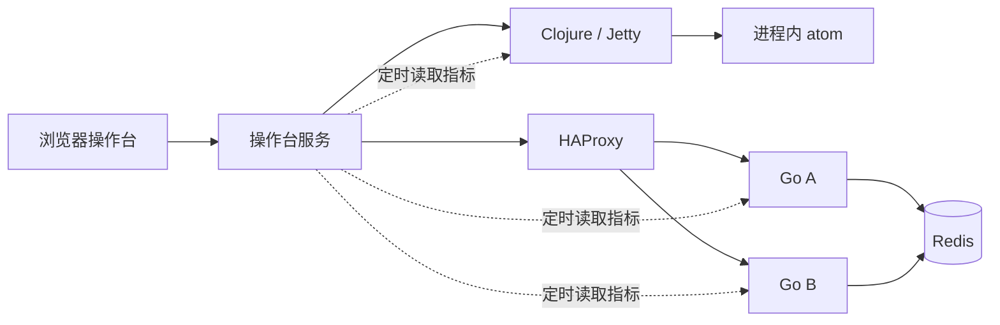

# 从零读懂 Clojure 漏桶：一次请求的完整路径

[简体中文项目指南](../README.zh-CN.md) · [English project introduction](../README.md)

## 先手算，再看 Clojure

假设 Alice 在第 0 秒连续请求五次，水位到 5。第 0.5 秒再请求，水位先降到 4.5，再加一会溢出，所以返回 429，并保存 **4.5、0.5 秒** 这对数据。第 1 秒再算，只需从 4.5 漏出 0.5，刚好能再装一份。如果只更新时间、忘记更新水位，前面那半秒就白等了；如果只更新水位、忘记更新时间，下一次会重复计算经过的时间。

先在仓库根目录运行 `make standard`，再执行下面的命令，就能在已启动的容器里打开 Clojure 交互环境。它使用独立的进程，你在这里定义变量不会改变 HTTP 服务里的桶。已安装 Clojure CLI 的读者也可以进入 `standard` 目录运行 `clojure`。

```sh
docker compose exec clojure java -cp 'src:/app/lib/*' clojure.main
```

把下面的表达式逐条粘贴进去，观察返回值。数值后的 `M` 是 Clojure 十进制数的字面量标记。

```clojure
(require '[limiter.core :as limiter])

(def empty-limiter (limiter/create-rate-limiter 5 1.0M))
(def decision (limiter/allow-request empty-limiter "alice" 0M))
(first decision)                                      ; true
(limiter/get-bucket-state empty-limiter "alice")      ; nil，旧值仍是空桶集合
(limiter/get-bucket-state (second decision) "alice")  ; 水位 1，结算于第 0 秒
```

`(函数 参数 参数)` 表示一次调用，`{:level 1}` 是 map，`[allowed? next-state]` 是两个返回值组成的向量。函数名里的 `?` 常用于布尔结果，`!` 常提醒调用会产生副作用。核心用 `assoc-in` 得到新 map，持久化数据结构可以共享未改动的部分。应用层的 `atom` 保存最新版本。跟着 [HTTP 处理器](../standard/src/limiter/http.clj) 的 `admit!` 阅读，就能看到“拿旧状态 → 纯函数 → 提交新状态 → 返回对应结果”的完整路径。

## 自己验证“拒绝不推迟恢复”

在同一个交互环境继续运行下面的例子，这次把容量设为 1，更容易看见边界。用 `Ctrl+D` 退出。

```clojure
(def small (limiter/create-rate-limiter 1 1M))
(def full (second (limiter/allow-request small "alice" 0M)))
(def halfway (limiter/allow-request full "alice" 0.5M))
(first halfway)                         ; false：0.5 + 1 超过容量
(:level (limiter/get-bucket-state (second halfway) "alice")) ; 0.5M
(first (limiter/allow-request (second halfway) "alice" 1M))  ; true
```

这里有两个不同的问题。纯函数回答“给这个旧状态和时间，应得到什么结果”；HTTP 层回答“并发进来时，谁能提交这个结果”。把它们分开后，单元测试只要传确定的时间，不必让线程睡眠来猜水位。

**为什么有了 `atom` 还要加锁？** 假设只剩一个名额，两个 Jetty 线程分别读取同一份旧状态，都可能算出“放行”。单次 `reset!` 是原子的，可是这两次“读旧值、判断、写新值”仍可能交错。`admit!` 把整个步骤放进同一个短临界区，返回与提交相对应的决定。这也意味着不同用户的提交在这个进程内串行，符合题面的单线程假设。将来真的遇到吞吐瓶颈，可以先测等待时间，再决定是否按用户分片。

## 一次请求经过哪些组件



演示台也能定向访问 Go A 和 Go B。实际业务调用可以直接访问 Clojure 或 HAProxy，关闭浏览器后仍会采集这些流量。

**为什么专门测 0.1 秒？** 满桶后每 0.1 秒重试，若逐次用二进制浮点数扣去 0.1，计算到第 1 秒的结果可能略高于 4，导致恰好够用的请求被错拒。标准核心用十进制数计算。Go/Redis 记录忙碌时段的起点和已放行的整数数量，按 Redis 微秒时间结算，不把每次展示的近似水位当作下一次计算的起点。两种实现都要通过同一条边界用例。

## 三分钟现场演示

1. 运行 `make up`，打开终端打印的操作台地址。在「请求实验」选 Clojure，为新用户突发 6 次，观察哪些收到 200、哪些收到 429。等一秒再单发，解释服务如何用经过的时间算出新水位。
2. 点击「验证跨实例共享」。读出每条记录的处理实例和用户：A 写入、B 查询、继续在 A/B 间准入。同一个用户只获得一份初始容量。再运行「用户隔离」，看换用户后的第一条请求。
3. 回到运行监控，选 Go 集群。用另一个终端向 8082 发请求，两次采样之间的增量也会出现在页面。放行和拒绝均属于成功作出的判定。Redis 不可用时，服务返回 503；全套隔离测试会实际停 Redis，页面此时能显示系统错误。
4. 如对方问如何验证正确性，打开 [共享用例](../contracts/cases.json)，讲第 0.5、0.75、1 秒的连续三步。然后展示 `make test` 的跨实例并发和失效恢复测试。

## 可能的追问

**为什么不用每秒清空一次或创建后台漏水线程？** 请求之间可能只隔 0.1 秒。按实际经过的时间懒计算，可以处理小数秒，工作量只跟发生访问的用户有关。GET 返回最近结算值及时间，能复现上一次判断。

**为什么仅靠轮询不能保证每个用户的额度？** 两份本地桶会让同一用户得到两份额度；粘性路由也会在副本故障或迁移时改变状态归属。Redis 把同一用户的状态与原子转移放在一个位置。额外代价是一次网络访问和共享存储依赖。

**为什么 Redis 挂了不临时放行？** 本项目选择额度优先，返回 503 让调用方知道结果未确认。对职位搜索这类偏可用性的读接口，业务也可以允许暂时退回本地桶，但需要接受故障期间跨实例超放。若搜索后端要防很多用户同时压满资源，还需评估整体并发上限。

**能宣称高可用或恰好一次吗？** 停掉 Go A 时 B 可以接手。单宿主机、单 Redis 和异步持久化都有明确限制。网络超时可能发生在写入成功之后，重试同一业务请求可能再次占用额度；需要端到端幂等时应另行设计请求标识和去重窗口。

**如果请求成本从 1 改成不同权重？** 首先改准入条件为“结算水位 + 成本不超过容量”。定义成本的有效范围，对正好填满、超容量和拒绝不追加水位增加共享用例，再同步调整 Clojure 函数、Lua 与 HTTP 契约。
